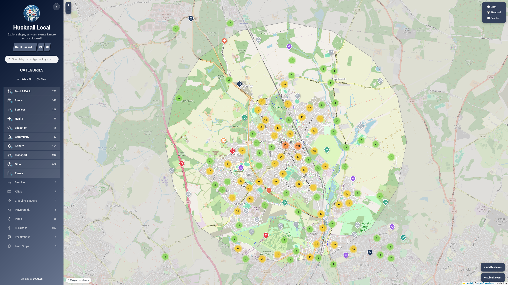

<!-- version 2 -->

<p align="center">
  <a href="https://github.com/pqpxo/multispace-localmap/blob/main/public/logo.png">
    
  </a>
</p>

<h1 align="center">Multi Space Local Map</h1>

<p align="center">
  <strong>One local map. Every place that matters.</strong><br>
  A self-hosted, customisable community map for UK towns, villages and neighbourhoods.
</p>

<p align="center">
  
  
  
  <a href="LICENSE"></a>
</p>

<p align="center">
  <a href="#features">Features</a> ·
  <a href="#quick-start">Quick start</a> ·
  <a href="#data-sources">Data sources</a> ·
  <a href="#customisation">Customisation</a> ·
  <a href="#deployment--configuration">Configuration</a>
</p>

---

## About

**Multi Space Local Map** turns open location data into a useful, searchable map for a local community. Discover shops, restaurants, services, schools, healthcare, parks and transport in one place — then let residents help keep that information up to date.

The platform is **location-independent**: choose an area during setup, add your own name and logo, select a theme, and import places. Run a separate instance for another area without changing the application code.

Built with **Flask, Leaflet and SQLite**, it runs in a single Docker container. No external database is required.

<p align="center">
  <a href="https://github.com/pqpxo/multispace-localmap/blob/main/localmap_screenshot.png">
    
  </a>
</p>

## Features

| | Feature | Description |
|---|---|---|
| 📍 | **Interactive local map** | Search, category filters, marker clustering and place details, including food hygiene information where available. |
| 🧭 | **Guided first-run setup** | Choose a location by postcode or place name, set a map radius, brand the site and import local places. |
| 🗂️ | **Six place-data sources** | Combine OpenStreetMap, FSA, NaPTAN, Overture, Foursquare and Google Places data. |
| 🤝 | **Community contributions** | Residents can suggest new places, submit corrections, report closures, leave reviews and propose events. |
| ✅ | **Moderation dashboard** | Review submissions before they appear publicly, manage settings and rerun data imports. |
| 🔎 | **Duplicate management** | Find overlapping records, review matches individually and merge without permanently deleting originals. |
| 🎨 | **Custom branding** | Upload your own logo, change site details, choose from 16 colour themes and customise fonts and map tiles. |
| 🔔 | **Notifications** | Optional email and Pushover alerts for submissions that need attention. |
| ♿ | **Accessibility** | Keyboard navigation, labelled controls, reduced-motion support and WCAG 2.1 AA-focused design. |

## Quick start

### Requirements

- Docker Engine with the Docker Compose plugin
- Git and Python 3 (to generate a secure admin token)
- A host port available on **8001** (or edit `docker-compose.yml`)
- Internet connectivity for the map tiles and whichever data imports you enable

### 1. Clone and configure

```bash
# version 2
git clone https://github.com/pqpxo/multispace-localmap.git
cd multispace-localmap

# The container runs as UID 1000; make its persistent directory writable.
mkdir -p data
sudo chown 1000:1000 data

# Create a private .env with a strong, randomly generated admin token.
# This does not depend on an .env.example file.
umask 077
python3 - <<'PY'
from pathlib import Path
import secrets

Path('.env').write_text(f'ADMIN_TOKEN={secrets.token_urlsafe(32)}\n')
PY
```

> **Important:** Keep `.env` and `data/` out of Git. They may contain credentials, database records and other private information. The repository must be accessible to your GitHub account in order to clone it.

### 2. Start the application

```bash
# version 2
docker compose up -d --build
docker compose logs -f
```

Open **`http://YOUR-SERVER-IP:8001`** and follow the first-run wizard. On startup, the application logs a randomised admin URL; save it somewhere secure. The `ADMIN_TOKEN` is required for admin API authentication.

> **Volume permissions:** Create `data/` *before* your first run. A root-owned bind-mount directory can prevent the non-root container from writing its SQLite database.

### 3. Set up your local area

| Step | What you'll configure |
|---|---|
| **1. Area** | Search by UK postcode or place name, position the marker, and choose a **1–10 km** radius. |
| **2. Branding** | Set the local map's name, tagline, colours and logo. |
| **3. Quick links** | Add links to useful local websites and resources. |
| **4. Data import** | Import places from the sources you want to use. Start with OpenStreetMap. |
| **5. Review** | Check your selections before saving. |
| **6. Done** | Save the site configuration and open the map. |

You can change area-specific settings later through the admin interface.

## Data sources

Start with **OpenStreetMap** to create the local place directory; other sources can enrich existing records and fill gaps. Matching considers business names and proximity to help reduce duplicates.

| Source | API key | Typical information |
|---|---|---|
| **OpenStreetMap (OSM)** | Not required | Shops, food venues, public services, schools, parks and amenities. |
| **Food Standards Agency** | Not required | Food hygiene ratings and food business records. |
| **NaPTAN** | Not required | Bus stops and public transport access points. |
| **Overture Maps** | Not required | Additional open place data queried from Parquet using DuckDB. |
| **Foursquare Places** | Required | Additional business profiles and contact details. |
| **Google Places** | Required; billing may apply | Opening hours, contact details and business information. |

Imports run as background jobs with progress updates and can be repeated from **Settings → Data sources**. The dashboard flags sources that have not been refreshed for **30 days**.

**Notes on third-party services:** Google Places pricing, credits and quotas can change. Review the current [Google Maps Platform pricing](https://mapsplatform.google.com/pricing/) and set an appropriate quota before importing. Overture releases also change over time; consult the [Overture documentation](https://docs.overturemaps.org/) if a pinned release is unavailable.

## Community contributions & moderation

Residents can submit new listings, updates to existing places, closure reports, reviews and local events. Submissions go to a moderation queue, where an administrator can approve, reject or remove them. Approved reviews appear against places; approved events are shown on the map.

When multiple providers describe the same location, **Settings → Duplicate places** lets an administrator inspect suggested matches, deselect incorrect matches and merge the remainder. The most complete record is retained, missing details are filled where possible, and linked reviews and reports are reassociated. Merged records are kept in the database rather than hard-deleted.

## Customisation

Each deployment has its own identity and map configuration. Set the **site name, tagline, logo, links, centre point and coverage radius** without modifying the source code.

### Themes & typography

Choose from **16 colour palettes**:

> Midnight · Forest · Harbour · Ocean · Claret · Heather · Terracotta · Charcoal · Sage · Slate · Plum · Moss · Denim · Cocoa · Indigo · Rust

Each theme updates backgrounds, surfaces, text, borders and accents together. You can also customise individual colours, select one of **five sidebar treatments** and choose from **ten font options**.

### Map backgrounds

| Map style | Key required |
|---|---|
| Light — Esri grey canvas | No |
| Standard — OpenStreetMap | No |
| Satellite — Esri | No |
| Light — CARTO | Yes |

The Esri grey canvas provides a key-free light-map option. CARTO tiles require a configured key.

## Deployment & configuration

| Item | Default / location | Purpose |
|---|---|---|
| Web port | `8001` | HTTP application port. |
| App settings | `data/config.json` | Location, branding and site configuration. |
| Database | `data/places.db` | SQLite records and community data. |
| Provider secrets | `data/secrets.json` | API credentials stored outside the public settings. |
| User uploads | `data/uploads/` | Persisted logos and other uploaded images. |
| Admin token | `.env` → `ADMIN_TOKEN` | Required secret; minimum **20 characters**. |
| Admin URL | `ADMIN_PATH` | Optional; randomised at startup when unset. |

### Optional environment variables

| Variable | Purpose |
|---|---|
| `ADMIN_PATH` | Use a fixed admin URL segment rather than a new random one at startup. |
| `SMTP_HOST`, `SMTP_PORT`, `SMTP_USER`, `SMTP_PASS`, `ADMIN_EMAIL` | Email notifications. |
| `PUSHOVER_TOKEN`, `PUSHOVER_USER` | Pushover notifications. |
| `DATA_DIR` | Application data directory (defaults to `data`). |

Google Places and Foursquare credentials are managed via the wizard or admin settings rather than the `.env` file. Provider secrets are stored separately in `data/secrets.json` with restricted permissions.

### Running multiple local maps

**One instance represents one area.** To serve another community, use a separate application directory, port, admin token and persistent `data/` directory. You can use the same image/codebase for both deployments; the selected location and branding are stored per instance.

For example, change the second instance's published Compose port from `8001:8001` to `8002:8001`, and open it on port `8002`.

### Reverse proxy / HTTPS

The container serves HTTP on port `8001`. For an internet-facing site, put it behind **Nginx, Caddy, Traefik or Nginx Proxy Manager** and enable HTTPS. When using Nginx, forward the original request information:

```nginx
# version 2
proxy_set_header Host $host;
proxy_set_header X-Real-IP $remote_addr;
proxy_set_header X-Forwarded-For $proxy_add_x_forwarded_for;
proxy_set_header X-Forwarded-Proto $scheme;
client_max_body_size 2m;
```

The application has one-hop `ProxyFix` support. Configure the trust boundary appropriately and avoid exposing the upstream application directly when it is intended to sit behind a reverse proxy. A random admin path is **not** a replacement for the admin token or network-level access controls.

## Security & accessibility

The application includes the following protections:

- Non-root container and static-file access restricted to `public/`.
- Separate storage for API secrets; sensitive keys are masked in the admin interface.
- Timing-safe admin token verification and a **five-attempt / 15-minute** lockout.
- Community submission rate limiting, input validation and a honeypot field.
- Setup endpoints restricted after initial configuration.
- Security response headers, including CSP and other browser protections.
- Keyboard-accessible controls, labelled form elements, focus indicators, screen-reader announcements, reduced-motion support and accessible touch targets.

These controls are not a substitute for sensible firewall rules, HTTPS, backups and keeping the host and container dependencies updated.

## Maintenance

```bash
# version 2
# View application logs
docker compose logs -f

# Rebuild and restart after pulling changes
docker compose up -d --build

# Stop containers without removing persistent files
docker compose down

# Check the number of active places (requires sqlite3 on the host)
sqlite3 data/places.db "SELECT COUNT(*) FROM places WHERE status='active';"
```

Back up the complete `data/` directory **and** your `.env` securely before major updates or migrations. Avoid publishing database files, uploaded content or tokens in a public repository.

### Run without Docker

The backend can also be run directly with Python, but Docker is the simplest supported deployment path:

```bash
# version 2
python3 -m pip install -r requirements.txt
mkdir -p data
export ADMIN_TOKEN="$(python3 -c 'import secrets; print(secrets.token_urlsafe(32))')"
python3 server.py
```

The default HTTP port is `8001`.

## Project structure

```text
# version 2
multispace-localmap/
├── server.py             # Flask API, imports, admin and setup
├── requirements.txt      # Python dependencies
├── Dockerfile            # Application container
├── docker-compose.yml    # Container and persistent storage
├── CHANGELOG.md          # Release history
├── INFO.md               # Project context
├── LICENSE               # MIT licence
├── public/               # Frontend resources
│   ├── index.html        # Interactive map
│   ├── setup.html        # First-run wizard
│   ├── admin.html        # Admin dashboard
│   ├── style.css         # Shared styles
│   └── logo.png          # Default app logo
└── data/                 # Generated, persistent data (keep private)
    ├── config.json
    ├── secrets.json
    ├── places.db
    └── uploads/
```

## Data attribution & licensing

**OpenStreetMap** data is licensed under ODbL and requires attribution. **FSA** and **NaPTAN** use UK open government data terms; **Overture** datasets have source-dependent licences. **Google Places** and **Foursquare** have separate usage, storage and redistribution terms. Review each provider's current conditions before publishing or redistributing imported data.

The **application source code** is licensed under the [MIT License](LICENSE). See the [Changelog](CHANGELOG.md) for release details.

---

<p align="center">
  <strong>Multi Space Local Map</strong><br>
  Built for local communities. Configurable for yours.
</p>
